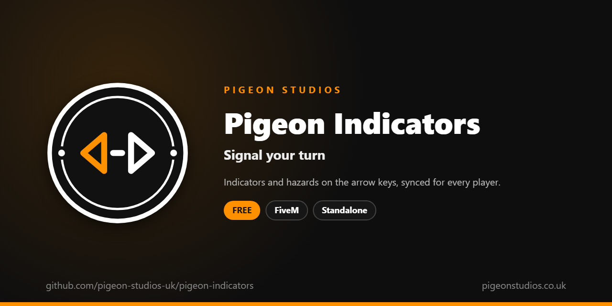

<div align="center">
  

  <h1>Pigeon Indicators</h1>

  <p><strong>Indicators and hazard lights on the arrow keys, synced for every player, and off by themselves after a turn.</strong></p>

  <p>
    <a href="https://github.com/pigeon-studios-uk/pigeon-indicators/releases/latest"></a>
    <a href="LICENSE.md"></a>
    <a href="https://discord.gg/2NFVWEUmDF"></a>
    
  </p>

  <p>
    <a href="https://github.com/pigeon-studios-uk/pigeon-indicators/releases/latest"><strong>Download</strong></a> ·
    <a href="#installation">Install</a> ·
    <a href="#configuration">Configure</a> ·
    <a href="CHANGELOG.md">Changelog</a> ·
    <a href="https://discord.gg/2NFVWEUmDF">Support</a>
  </p>
</div>

---

## Contents

- [Overview](#overview)
- [Features](#features)
- [Requirements](#requirements)
- [Installation](#installation)
- [Updating](#updating)
- [Configuration](#configuration)
- [Localisation](#localisation)
- [Commands and exports](#commands-and-exports)
- [How it works](#how-it-works)
- [Update checker](#update-checker)
- [Performance](#performance)
- [Security](#security)
- [Troubleshooting](#troubleshooting)
- [FAQ](#faq)
- [Support](#support)
- [Contributing](#contributing)
- [Licence](#licence)
- [Credits](#credits)

## Overview

Pigeon Indicators is a free resource by [Pigeon Studios](https://pigeonstudios.co.uk) that gives drivers working indicators and hazard lights. GTA's vehicles have them, but players have no key for them, and when a script turns them on, other players don't see it.

Press Left or Right to indicate and Down for the hazards; press the same key again to turn them off. After a turn, the indicator turns itself off once the wheel is straight, like a real car. Everyone nearby sees the lights, including players who arrive after they were turned on.

## Features

- **Three keys.** Left, Right and Down arrows by default, which players can change in GTA's key bindings.
- **Seen by everyone.** The lights are kept on the vehicle, so every player sees them, even ones who arrive later.
- **Off after a turn.** The indicator cancels itself once the vehicle has turned and the wheel is straight. Lane changes keep it on.
- **Hazards stay on.** They stay on when the driver gets out, for broken-down cars and traffic stops.
- **Only the driver.** Passengers can't touch them, and the server checks it.
- **For other resources.** An export and a state bag show which lights are on.
- **23 languages.** Follows ox_lib's language, or set your own.
- **Standalone.** No framework or other resources needed.

## Requirements

| Requirement | Version | Notes |
|---|---|---|
| FXServer | A [recommended artifact](https://runtime.fivem.net/artifacts/) | |
| OneSync | On | The default on current servers |
| [ox_lib](https://github.com/communityox/ox_lib) | Optional | Used for the language if it's running |

**Frameworks:** none needed. It works the same on standalone and vMenu servers, ESX Legacy, QBCore, Qbox and ox_core.

## Installation

1. **Download** `pigeon-indicators.zip` from the [latest release](https://github.com/pigeon-studios-uk/pigeon-indicators/releases/latest). Don't use the green **Code** button; release zips are the tested builds.
2. **Extract** it into your server's `resources` folder. The folder must be called `pigeon-indicators`.
3. **Start it** by adding this to `server.cfg`, after ox_lib if you use it:

   ```cfg
   ensure pigeon-indicators
   ```

4. **Configure** it in `configuration/config.lua` if you want to change anything. The defaults work as they are.
5. **Restart** your server. The console shows one line from the update checker:

   ```text
   [Pigeon Studios] Pigeon Indicators v1.0.0 is up to date.
   ```

## Updating

1. Read the [changelog](CHANGELOG.md) for every version between yours and the latest, especially any **Upgrade notes**.
2. Back up your `configuration/` and `locales/` folders.
3. Replace the `pigeon-indicators` folder with the new release.
4. Copy your changed settings into the new `configuration/config.lua`. Don't copy the old file over the new one; new versions can add settings.
5. Restart the resource.

## Configuration

All settings are in `configuration/config.lua`, each explained by a comment next to it.

| Setting | Default | What it does |
|---|---|---|
| `Config.Locale` | `'auto'` | The language of the key binding names. `'auto'` follows ox_lib's; or a code such as `'de'` (see [Localisation](#localisation)) |
| `Config.Keys` | `LEFT, RIGHT, DOWN` | The default keys for left, right and hazards. Players can change them in GTA's key bindings |
| `Config.Commands` | `indicatorleft, indicatorright, hazards` | The command names, which the keys run |
| `Config.AutoCancel` | `true` | Turn the indicator off after a turn. `false` keeps it on until pressed again |
| `Config.CancelDegrees` | `50` | How far, in degrees, the vehicle must turn before the indicator can cancel |
| `Config.BlockedClasses` | `{ 13, 14, 15, 16, 21 }` | Vehicle classes without indicators: cycles, boats, helicopters, planes and trains |

## Localisation

Pigeon Indicators comes in 23 languages: `en` English, `cs` Czech, `da` Danish, `de` German, `es` Spanish, `et` Estonian, `fi` Finnish, `fr` French, `hr` Croatian, `hu` Hungarian, `id` Indonesian, `it` Italian, `nl` Dutch, `no` Norwegian, `pl` Polish, `pt` Portuguese, `pt-br` Brazilian Portuguese, `ro` Romanian, `sl` Slovenian, `sv` Swedish, `tr` Turkish, `zh-cn` Simplified Chinese and `zh-tw` Traditional Chinese. They're the languages ox_lib ships, so your server may already have one set.

With `Config.Locale = 'auto'` (the default), it uses ox_lib's language, so one line in `server.cfg` sets it for this and every other resource that follows ox_lib:

```cfg
setr ox:locale "de"
```

Use `setr`, not `set`, so players' games get it too. Without it, or for a language that isn't in `locales/`, the text is English. To choose a language for this resource only, set `Config.Locale` to its code, such as `'fr'` or `'pt-br'`.

The only text is the key binding names in GTA's settings, which are set the first time a player joins, in the language the server had then. Chinese text can show as blank in GTA's own text, such as its notifications, because GTA only loads its Chinese font when the game itself is set to Chinese. ox_lib's notifications show every language.

Every file was checked for missing text and placeholders, but not every translation has been read by a native speaker yet. If something reads wrong, please send a fix; see [Contributing](#contributing). To add a language, copy `locales/en.lua` to a new file named with the language's code (such as `ja.lua`), change `Locales.en` at the top to match (`Locales.ja`), and translate the text in quotes.

## Commands and exports

### Commands

| Command | Who | What it does |
|---|---|---|
| `/indicatorleft` | Drivers | Left indicator on, or off. The Left arrow runs it |
| `/indicatorright` | Drivers | Right indicator on, or off. The Right arrow runs it |
| `/hazards` | Drivers | Hazard lights on, or off. The Down arrow runs it |

Pressing one while another is on switches to it.

### Exports

Client export, for other resources in the player's game:

```lua
-- 'left', 'right', 'hazard' or nil, for a vehicle (the player's own if none is given).
local lights = exports['pigeon-indicators']:GetIndicators(vehicle)
```

### State bag

Each vehicle with its lights on has a replicated `pigeonIndicators` state bag, set by the server: `1` left, `2` right, `3` hazards, or `nil` when they're off.

```lua
-- Server or client
local lights = Entity(vehicle).state.pigeonIndicators
```

## How it works

GTA doesn't sync indicators between players: lights a script turns on are only seen in that player's game. So when the driver presses a key, their game turns the lights on straight away and asks the server, which checks the player is the vehicle's driver and isn't sending too many changes, then keeps the lights in the vehicle's `pigeonIndicators` state bag. Every player's game turns the lights on and off to match it, when it changes and when the vehicle comes into range.

For auto-cancel, while the left or right indicator is on, the driver's game adds up how far the vehicle turns that way, ten times a second. Once it has turned `Config.CancelDegrees` and the steering is straight again, it turns the indicator off. A lane change doesn't turn far enough, and turning the other way doesn't count. Hazards never cancel themselves.

## Update checker

When it starts, Pigeon Indicators checks our public [version registry](https://github.com/pigeon-studios-uk/pigeon-versions) once and prints one line in the server console saying whether it's up to date. If there's an update, it shows what's new and where to get it. The check is a single request to GitHub and sends nothing about your server or players.

Control it for every Pigeon Studios resource at once in `server.cfg`:

```cfg
set pigeon_update_check "on"      # default: one line per resource
set pigeon_update_check "quiet"   # only when there's an update or a problem
set pigeon_update_check "off"     # never check
```

## Performance

Nothing runs while the lights are off, apart from the key bindings. While an indicator is on, the driver's game reads the heading ten times a second. Each change is one small message to the server and one state bag update. Nothing runs on the server between changes.

## Security

- The server checks every change: the vehicle exists, the player is its driver, the value is one of the four allowed, and they aren't sending more than a few a second. Anything else is dropped.
- The state bag is set only by the server, so players' games can't change another vehicle's lights directly.
- The only network request is the update check at start-up, from the server to GitHub. It sends nothing about your server or players.

Found a problem? Please don't open a public issue. Use the **Report a vulnerability** button in this repository's **Security** tab, or follow our [Security Policy](https://github.com/pigeon-studios-uk/.github/blob/main/SECURITY.md).

## Troubleshooting

**Nothing happens when I press the arrows.**
Check the keys in **Settings → Key Bindings → FiveM → Indicator left** and the others; if another resource uses the arrows in vehicles, change one of them. You need to be the driver, and the vehicle can't be a bicycle, boat, aircraft or train.

**Other players don't see my indicators.**
Make sure OneSync is on and the resource is started on the server, not just in your game. Other resources that set indicators every frame can also override them.

**The indicator turns off too soon, or not at all.**
Change `Config.CancelDegrees`: lower to cancel after smaller turns, higher for bigger ones. Or set `Config.AutoCancel = false`.

**The text is in the wrong language.**
Check `setr ox:locale` in `server.cfg` (with `setr`, not `set`), or set `Config.Locale` to the language's code.

**The console says "isn't in the version registry" or "couldn't check for updates".**
Your server couldn't reach GitHub, or the check is blocked by a firewall. The resource works normally either way. Turn the check off with `set pigeon_update_check "off"`.

## FAQ

**Is it really free?**
Yes. Use it on as many servers as you like, including ones that take donations. You just can't reupload, resell or bundle it. See [Licence](#licence).

**Does it work on standalone and vMenu servers?**
Yes. It needs no framework at all, and works alongside vMenu.

**Does it work on motorbikes?**
Yes, on any vehicle with indicator lights. Only bicycles, boats, aircraft and trains are left out by default.

**Does it work with my vehicle HUD?**
Yes. HUDs can show the lights with the `GetIndicators` export or the state bag.

**Does it need OneSync?**
Yes, for the vehicle state bag. OneSync is on by default on current servers.

## Support

Read [Troubleshooting](#troubleshooting) first, then ask in the support channels of our [Discord](https://discord.gg/2NFVWEUmDF). Please include your Pigeon Indicators version, FXServer artifact and any errors from the console (F8 in game). See [Getting help](https://github.com/pigeon-studios-uk/.github/blob/main/SUPPORT.md).

Found a bug? Open a [bug report](https://github.com/pigeon-studios-uk/pigeon-indicators/issues/new/choose).

## Contributing

Fixes, improvements and translations are welcome. Please read the [contributing guide](https://github.com/pigeon-studios-uk/.github/blob/main/CONTRIBUTING.md) first, and open a feature request before working on anything big.

## Licence

Pigeon Indicators is free to use under the **[Pigeon Studios Free Licence](LICENSE.md)**.

- ✅ Use it on any number of servers, including monetised ones
- ✅ Change it for your own servers
- ✅ Show it in videos and streams
- ❌ Don't reupload, share or mirror the files; link to this repository instead
- ❌ Don't sell it, bundle it in packs, or put it behind escrow
- ❌ Don't remove the credits

This summary isn't the licence; [LICENSE.md](LICENSE.md) is. Third-party components are listed in [NOTICE.md](NOTICE.md).

## Credits

Made by [Pigeon Studios](https://pigeonstudios.co.uk). Thanks to everyone who has contributed fixes and translations; see the [changelog](CHANGELOG.md).

<sub>Not affiliated with or endorsed by Rockstar Games, Take-Two Interactive or Cfx.re.</sub>
